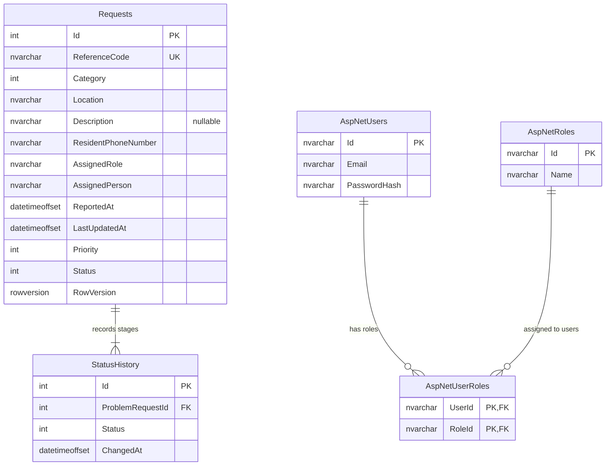

# Database diagram

Each request begins with a Submitted history entry, followed by one entry per forward transition through Assigned, In Progress, Resolved, and Closed. `Requests.Id (1) -> StatusHistory.ProblemRequestId (many)` is a required relationship. Identity also creates standard claim, login, token, and role-claim tables. EF tracks applied migrations in `__EFMigrationsHistory`. Requests store the resident SMS number and the assigned municipal role/person needed for notifications, but residents still do not need accounts.
