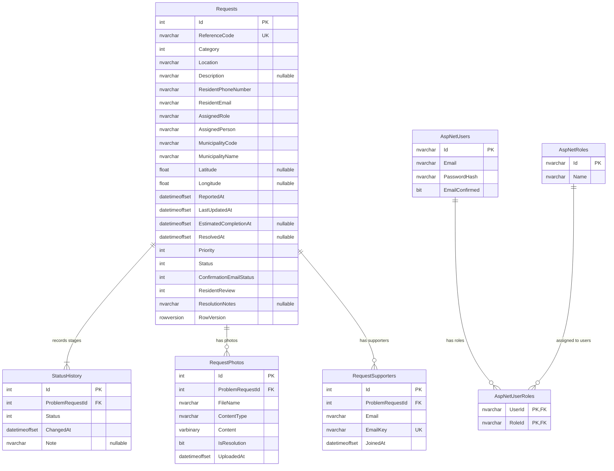

# Database Diagram

The schema below reflects the current model after all four migrations.

## Notes

- `Requests.ReferenceCode` has a unique index (format: `MUN-{24 hex chars}`).
- `RequestSupporters` has a unique composite index on `(ProblemRequestId, EmailKey)` where `EmailKey` is the SHA-256 hash of the uppercased email — prevents duplicate support entries per report.
- A composite index on `(MunicipalityCode, Status, ReportedAt)` supports the admin dashboard filter queries.
- Check constraints enforce valid enum ranges: `Category` (0–6), `Priority` (0–3), `Status` (0–4).
- All child tables (`StatusHistory`, `RequestPhotos`, `RequestSupporters`) cascade-delete when the parent `Request` is deleted.
- `RowVersion` is a native SQL Server `rowversion` column; on PostgreSQL it is a `bytea` managed manually in application code.
- ASP.NET Identity also creates standard tables for claims, logins, tokens, and role-claims. EF Core tracks applied migrations in `__EFMigrationsHistory`.

## Migration history

| Migration | Date | Changes |
|---|---|---|
| `InitialCreate` | 2026-10-07 | Base `Requests` and `StatusHistory` tables, ASP.NET Identity tables |
| `UpdateMunicipalModel` | 2026-10-08 | Added `ResidentEmail` to `Requests` |
| `RequestRouting` | 2026-10-08 | Added `MunicipalityCode`, `MunicipalityName`, `Latitude`, `Longitude`, `EstimatedCompletionAt`, `ConfirmationEmailStatus` |
| `CommunityFeatures` | 2026-10-12 | Added `RequestPhotos` table, `RequestSupporters` table, `ResolvedAt`, `ResidentReview`, `ResolutionNotes` on `Requests`, `Note` on `StatusHistory`, composite index on `(MunicipalityCode, Status, ReportedAt)` |
